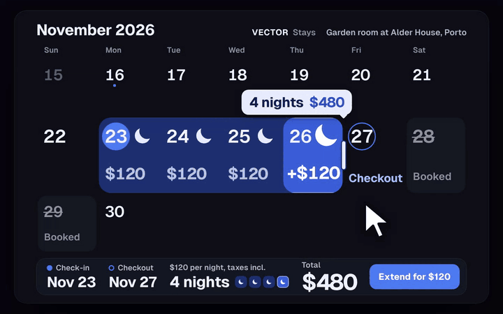

# Extend Stay

**Your stay is a band of nights. Pull its end one day further and a new night rises with its moon.**



**Live demo:** [veraetogrex-portfolio.github.io/extend-stay](https://veraetogrex-portfolio.github.io/extend-stay/) · **Mockup:** [full-screen version](https://veraetogrex-portfolio.github.io/extend-stay/mockup/extend-stay.html)

A hotel booking screen where the stay is drawn over the month as one dark-blue band, a moon and a price on every night. Grab the band's right edge and drag it: each day it crosses lifts in as a lighter night with "+$120", and the tag riding the edge counts the nights and the total. Nights someone else has booked stop the edge. The booking bar under the month keeps the same count: check-in, checkout, one moon per night, the total and what the change costs.

## Use it

Three files, no build step, no dependencies, no web fonts:

```
index.html   markup
style.css    styles
script.js    data, layout and animation
```

Download the repo and open `index.html`, or copy the three files into your project.

## Try it

- Drag the handle on the band's right edge. Thursday joins the stay: 4 nights, $480, "Extend for $120". Drag it back to shorten the stay.
- Focus the handle and use ← → (or ↑ ↓) to move checkout by a night. Past a booked night or below one night the edge only leans and comes back.
- Click a day after check-in to make it the checkout, or a day before check-in to arrive earlier. You can check out on the morning a booked night starts (Nov 28).
- Press Esc to put the stay back the way it is booked.
- Click "Extend for $120" (or "Shorten stay"): the change becomes the booking and the button says "Stay updated".

## Make it yours

At the top of `script.js`:

- `YEAR`, `MONTH` and `TODAY`: the month shown and today's date. Weeks wholly in the past are left out.
- `RATE`: dollars per night.
- `BOOKED`: the stay as booked (`{ in: 23, out: 26 }` — check-in and checkout days).
- `TAKEN`: nights other guests hold. The edge stops at the first one.
- `CW`, `CH`, `TALL`, `R`: day cell width, week row height, the taller week of the stay, band corner radius (px).

Colours live in `:root` in `style.css`: `--night` for booked nights, `--night-add` for nights you add, `--moon` for the moons and the tag, `--harbor` for check-in, checkout and the button.

## What's in `mockup/`

The full 1440×900 screen this component was shot in for the reel:

- `mockup/extend-stay.html` — interactive. `D` plays the demo, `R` resets.
- `mockup/extend-stay.autoplay.html` — the scripted loop the reel was recorded from.
- URL flags: `?frame` puts the screen in a browser window, `?clean` hides the control panel, `?once` plays the demo once.

The mockup loads the same `style.css` and `script.js` from the root, plus a shared stage runtime and bundled fonts from `mockup/_shared/`. The component in the root doesn't need any of it.

---

Component 33 of a series. New one every day on Instagram [@veraetogrex_portfolio](https://www.instagram.com/veraetogrex_portfolio/) · all components: [github.com/veraetogrex-portfolio](https://github.com/veraetogrex-portfolio)

MIT licensed.
